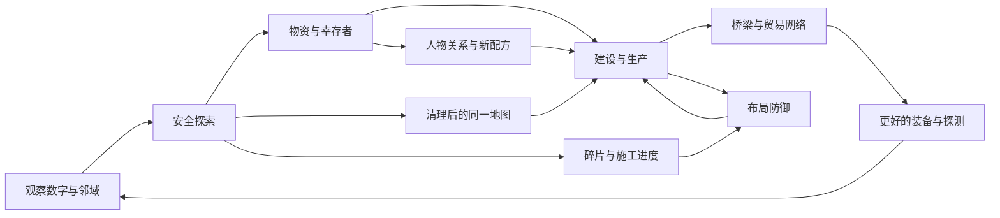

# 地下回响 / Underground Echoes

产品需求文档 · v0.1 · 2026-10-26

**一句话：扫开一格废土，救回一个人，把脚下的安全地带连成可以自我生长的家园。**

状态：教学与基础探索已形成第一版可玩实现；建设、生产、交通、经济、麻将回收和塔防为后续需求，本文不把它们描述为已完成。名称「地下回响」为本次设计工作名。数值、角色名和章节节奏为设计建议，待试玩校准。

## 1. 问题与产品目标

现有小游戏是彼此独立的入口，单局结束后缺少情感与资产积累。玩家玩的是规则，却没有在同一个世界里留下东西。产品要让扫雷从“避免犯错”变成“通过判断，为人们找回生活空间”。

核心体验有三个层次：

1. **即时满足**：看懂数字 → 推理 → 开出安全区域 → 获得轻量的正向反馈。
2. **积累可见**：安全地块 → 工坊与居民 → 更稳定的生产 → 更好的探测和运输能力。
3. **关系生长**：救人 → 认识他们 → 连接不同聚落 → 独特产品与组合剧情 → 愿意继续探索。

主页只负责让人进入作品。主入口突出小说工作台与 AI 狼人杀，均明确建设中；小游戏进入自己的故事空间。减少身份介绍、宏大口号和重复入口，以可见交互呈现内容。

## 2. 交付边界

用户选择本次先做「可玩的扫雷教学与基础探索，再给完整世界观和系统 PRD」。

| 系统 | 本次 P0 实现 | 后续目标 |
| --- | --- | --- |
| 首页与游戏室 | 小说／狼人杀主卡、建设中状态、精简介绍；游戏室突出地下回响 | 项目进展与实际内容继续迭代 |
| 教学 | 固定九宫格，实际开格／标记／展开练习，随时重看 | 进阶推理、连通建设与防御教学 |
| 扫雷 | 9×9、10 雷、中央安全入口、复用无猜生成器、邻域框 | 多地形、不同尺寸、任务约束 |
| 探索 | 随机物资、每区一位幸存者、累计原料与居民 | 多角色、事件选择、任务链 |
| 爆炸 | 当前格爆坑、周围未领取物资损毁、少量原料损失，继续游戏 | 地形与设施损伤、救援修复 |
| 区域 | 清完进入下一随机区域；保留上一张已清理地图 | 可回访的坐标世界与无限分区生成 |
| 存档 | 游客本机自动保存，版本校验 | 云端同步、迁移、跨设备 |
| 建设与生产 | 仅作为后续章节提示 | 同图建造、食物供给、科技、复利 |
| 交通与经济 | 未实装 | 单一货币、桥／轨道、商人、NPC 产品 |
| 麻将回收 | 既有麻将仍是独立游戏 | 接入拆雷装置与回收物流 |
| 塔防 | 未实装 | 当前探索地图 + 上一区域防御同屏 |
| 好友基地 | 未实装 | 系统安排的远征据点；真实好友另行接入 |

本次保留经典扫雷模式及其独立排行榜。探索模式不上传经典扫雷成绩，二者的失败规则与结算完全独立。

## 3. 世界与叙事

地表网络在一场连锁灾害后失联。过去用于设施防护的地下雷网失去控制，把水站、仓库、隧道和聚落切成孤岛。玩家是第一支地下勘探队的组织者。基地灯光很弱，居民最初只有三人；搜到的不是抽象分数，而是能支撑下一次出发的材料、设备和人。

地下保有旧工业遗产。科技重建遵循“找到实物 → 理解用途 → 恢复供电 → 稳定制造 → 联通物流”的因果链。世界不需要每次进入都读一段前情：灯是否亮、工坊是否工作、桥上是否有运输车，直接表现状态。

**叙事交付**：事件卡一条人物台词、一张小画像／场景、最多两个清晰选择。完整记录收进无线电日志，不阻断连续开格。初遇重要人物最多一次强提示，重复事件只在侧栏显示。人物遭遇必须由开出的地块触发，不能靠无关随机弹窗打断。

| 章节 | 触发与保底 | 玩家学到什么 | 世界变化 |
| --- | --- | --- | --- |
| 00 灯还亮着 | 首次进入 | 数字、开格、标记、展开 | 地下入口亮起 |
| 01 地下的敲击声 | 第一区保证幸存者与回收物资；P0 已覆盖基础事件 | 出错有代价但能继续 | 居民从 3 增至 4 |
| 02 在这里安家 | 清理首区后，建设更新开放 | 安全格直接成为可建地块 | 同一地图出现仓库与工坊 |
| 03 河的另一边 | 完成基础供给后，第 3—5 区内保证友方据点 | 桥梁、贸易、单一货币 | 两处灯光通过运输路线连接 |
| 04 夜里的脚步 | 已有至少一座可用防御塔后才能触发 | 边探索边为上一张图提供建造进度 | 第一波可预测入侵 |
| 05 旧物的新用途 | 安全拆雷与精密工坊解锁 | 雷芯封装、麻将匹配回收 | 危险物变为生产原料 |
| 后续章节 | 按网络节点数、生产能力和人物关系触发 | 多区域分工与网络收益 | 从营地成长为聚落群 |

P0 每区的同类幸存者台词只是机制占位。正式剧情需用事件 ID 保证首次人物遭遇唯一，重复救援改为短广播，避免“无限复制同一个人”。

## 4. 核心循环与用户故事

1. 作为第一次玩扫雷的人，我希望在一个固定九宫格里亲手练习，从而理解数字而不是记一段说明。
2. 作为熟练玩家，我希望收起教学直接探索，并能随时重新展开。
3. 作为鼠标玩家，我希望移动到一格便框出它及周围八格，避免看错数字作用范围。
4. 作为手机玩家，我希望用明显的开格／标记切换完成同样操作，不依赖右键。
5. 作为键盘玩家，我希望能聚焦格子、按 Enter 开格、按 F 标记，并听到格子状态。
6. 作为色觉差异玩家，我希望每格保留清楚的数字和文字状态，不靠颜色独自传达危险。
7. 作为探索者，我希望安全开格有轻微动画和收益反馈，但不被弹窗打断。
8. 作为犯错的玩家，我希望知道损失发生在哪里，并保有继续玩的资源与路径。
9. 作为探索者，我希望收集物资和救出居民能改变基地，而不只是改变计数。
10. 作为建设者，我希望直接在刚清理的地图上规划，不切到与经历无关的新沙盘。
11. 作为建设者，我希望看见入口、可达性、资源和射程，理解为什么某处适合建设。
12. 作为经营者，我希望早期投入带来稳定的未来收益，并看见回本进度。
13. 作为经营者，我希望只有一种支付货币，不在多个钱包之间兑换。
14. 作为角色收集者，我希望每位 NPC 提供独特能力或产品，并有可追踪的成长。
15. 作为关系探索者，我希望通过连接人物据点触发组合产品与剧情。
16. 作为运输规划者，我希望桥梁能跨越雷区屏障，再升级为稳定运输路线。
17. 作为探索者，我希望偶遇商人并做一次有限、清楚的取舍。
18. 作为拆雷者，我希望回收危险雷芯成为一段轻松的麻将玩法，并得到可用产物。
19. 作为防御者，我希望探索与塔防同屏，随时知道上一张图的风险。
20. 作为慢速推理玩家，我希望可以暂停研究数字，不因看教程而让基地被毁。
21. 作为高效玩家，我希望连续安全判断能加快建设，但错误操作不能刷进度。
22. 作为游客，我希望刷新后保留本机进度，不必先注册。
23. 作为长线玩家，我希望按进度发现新区域与故事，读档不会重置地图或刷新商店。
24. 作为社交玩家，我希望区分系统据点与真实好友贡献，不误以为机器人是真人。

## 5. 扫雷与教学规范

### 5.1 规则

- 数字等于周围八格的雷位数量，不包含自己。边缘只框地图内实际存在的邻格。
- 左键／点击翻开；右键／F 标记。手机提供带文字与选中态的标记模式按钮。
- 已标记格必须先取消标记才能翻开。对已打开数字格，周围确认雷位数匹配数字才展开其余邻格。
- 旗子只是玩家判断，误标可导致展开触雷；不能用旗子数量验证真实地雷位置。
- P0 使用固定中央入口保证起步九宫格无雷，并从这一入口验证整盘可逻辑求解。首次点击其它格仅提示入口，不消耗资源或生成新局。
- P0 已爆炸雷位仍计入数字，但作为已确认雷位参与展开。数字不会在爆炸后偷偷变化。后续拆雷系统若需要移除雷位，必须明确切换到“清理视图”并重新计算显示，不能混用两套数字语义。
- 清理完成条件是所有非雷格已打开；未爆炸雷格之后仍是危险地块，不能直接建造。标旗不等于完成拆雷。

### 5.2 教学顺序与反馈

固定小棋盘由同一个格子组件呈现，中心九宫格轮廓一直存在。第一步读数字；第二步点击明确安全格；第三步从已知条件推理并右键标雷；第四步另起一小段明确标注的练习，点击中心数字展开其余格；最后进入真实地图。做错只给一句局部提示，不扣资源。

主地图鼠标悬停或键盘聚焦时框住邻域。格子在移动设备上保持约 32px 以上；框线不拦截点击。后续加入手机单击查看／二次确认作为可选无障碍模式。

数字采用深色字与浅色底，具体参考用户提出的 Ubuntu 扫雷方向，由本项目实现配色：1 绿、2 黄、3 橙、4 红、5—8 逐渐加深。数字始终保留，不把红绿识别当作操作前提。安全开格使用短促缩放／亮度变化与小计数反馈；尊重减少动态效果设置。音效后续可选，默认不自动播放。

## 6. 探索、奖励与失败

### 6.1 P0 已实现数值

每区 9×9，10 雷，71 安全格。安全格约 26% 放置物资，每份 3 原料；入口保证一份；每区一名幸存者，不能在入口九宫格内。零格洪泛展开照常领取新格物资。领取状态随地图保存，同一格不重复计奖。

踩雷只标记该雷位为爆坑，损毁它周围八格尚未领取的物资，每颗触雷最多损失 3 个已持有原料、余额最低为 0。幸存者不被这次 P0 爆炸删除。一次展开可能同时触及多个雷，先统一结算损毁，再发放这次安全格的奖励，避免先领取后销毁的顺序漏洞。

P0 原料是实物库存，**不是货币**。居民暂时只累计，不消耗食物；食物与供给循环属于建设版本，不在试玩里假装已运行。

### 6.2 后续损伤模型

- 本区临时收益、最近施工进度承担主要损失；核心居民、已解锁配方与历史资产不被一次误触全部清空。
- 爆炸影响半径 1 格；最多中断邻近的一项施工并回退不超过 20% 工时。已建基地不与当前探索区的爆炸跨区联动受损。
- 弹出简短损失清单，地图标出损伤区域；修复需要原料与工时，不额外引入“复活币”。
- 破产保底：入口补给、基础回收任务和初级手工作坊不需要货币，必须始终留出重新发展的路径。

## 7. 同图建设与第一性原理科技树

建设必须使用刚刚扫过的同一张网格。地块具有已探索、雷位、爆坑、通行、占用、坡度与基础承载属性。进入建设模式只切换图层，不重置布局。安全且与入口四方向连通的地块才可建设；邻接雷区不会无条件阻止在安全格施工。

电力是容量，食物是消耗品，材料是实物，货币只负责交易。这些不是多个币种。建筑放置前必须展示成本、占地、可达性、能源输入和预计回本；无路可达或会封死唯一通路时直接禁止。

| 技术阶段 | 先决条件／因果链 | 解锁 | 需要支付或承担什么 |
| --- | --- | --- | --- |
| 求生 | 安全通路、回收原料、居民劳力 | 仓库、寝区、手工作坊、滤水 | 原料、地块和工时 |
| 稳定生活 | 净水 + 工具 + 可用能源 | 菌菇温室、医疗角、基础电池 | 食物供给与维护 |
| 可靠供电 | 铜材回收、绝缘材料、发电机修复 | 充电站、固定式探测器、电机工坊 | 燃料／能源输入、损耗 |
| 搬运 | 结构材料 + 锚点 + 承重验证 | 人行桥、牵引装置、运输拖车 | 承载限制、连接距离 |
| 工业物流 | 稳定电网 + 两端设施 + 路线通畅 | 桥面轨道、货运索道、分拨仓 | 电力容量、维修、运力瓶颈 |
| 精密制造 | 机械师 + 电工 + 工作台精度 | 单格探测器、雷芯封装、塔防模块 | 输入材料、产能与冷却时间 |
| 高级网络 | 中继节点、可靠线路、研究任务 | 远程协作与运输自动化 | 网络覆盖和节点维护 |

《死亡搁浅》的启发主要是：**跨越地形的运输工具、持续可用的基础设施、连接孤立的人，以及他人留下的建设成果**。桥、充电点、货运路线等可用现实的材料与能量约束解释。其虚构高科技不能被称为已验证的现实物理；若后期引入类似快速制造的架空技术，应标注世界观假设，并继续遵守材料、能量、容量和维护约束，避免无成本凭空造物。

## 8. 生产、复利与单一货币

唯一支付货币暂定 **联结券**。首次连通外部聚落后开放钱包、报价与交易；之前只发生实物回收和建设，不提前展示灰色钱包。首次交易任务发 30 券保底，不要求玩家先出售维生用品。

物资库存初期只保留原料、零件、食物三类；特殊人物产品作为具体道具，不是新的通用支付单位。不能将「科技点」「拆雷币」「友谊币」做成第二、第三钱包。

**复利来源是再投资后的产能增长，收益必须来自生产和交换。** 例如工坊每 10 个模拟工时产出 4 原料，扣 1 原料维护净得 3；花 12 原料升级后每周期净得 5，增量 2 的回本周期为 6。连接运输节点若每周期节省 1 原料等价运输成本，投入 8 的桥在 8 个周期回本。该例仅用于数值初稿，实际以模拟与试玩调整。

每次升级明确显示当前／升级后的净产出、维护与回本周期。玩家能看到货车变多、货架变满、路线变亮；不用连续跳动的巨大数字代替成长。居民必须有岗位、食物与住所；产能受劳力、运输、电力、库存上限约束，阻止无条件指数爆炸。

P1 生产以模拟工时推进，主动探索与安全运输推进时间。离线收益先不做；P3 如加入，使用服务端时间、容量上限和最长 8 小时封顶，不允许修改本机时钟刷产出。

商人每 3—5 个完成区域出现一次，路线选择前提示大致机会；每次固定 3—5 件商品与一个收购需求。到访时锁定货单和价格，读档不刷新。买入价必须高于同店回售价，套利需跨区运输、库存或风险成本，不能同页无限倒卖。缺钱不阻断主线。

## 9. 雷芯 → 麻将 → 资源

“地雷变成麻将”的世界解释：拆雷装置将已确认雷位的危险组件安全封装为带符号的回收匣，界面以麻将牌表达组件型号。消除是拆解配对操作，产物来自原本的材料，不能让爆炸物无中生有地产出钱。

流程：已清理区域 → 工程师与拆雷装置到场 → 确认雷位并拆除 → 生成可回收牌组 → 完成匹配 → 入库原料／零件。每个雷位只有一个回收凭证，退出重进不再发牌。已爆雷只能低比例回收，不能通过主动引爆获得更高收益。

P2 明确采用二维连连看，独立规则模块要求连接路径最多两次转弯、路径无阻挡；现有叠层麻将只复用牌面组件与奖励适配，不复用其“自由牌”匹配规则。P0 的独立麻将入口继续保留，不把它误称为已完成的雷芯连连看。

配对失败只保留局面，不消耗已入库资产。每局保证可解或提供有限重排；奖励取决于这批待拆雷芯的总量，不靠重复开局或无限重排增长。塔防来临时自动保存并暂停拆解，不让两套操作争抢输入。

## 10. NPC、桥梁与经济网络

| 工作名 | 特长／独有产品 | 单人能力 | 联通后的组合 |
| --- | --- | --- | --- |
| 阿砾，机械修复师 | 牵引齿轮 | 工坊效率与桥面卷扬 | 与岑灯合作生产单格探测器 |
| 岑灯，无线电技师 | 感应线圈 | 地雷信号校准 | 与阿砾触发「给失联者的第一封信」 |
| 白禾，栽培者 | 耐阴菌种 | 食物生产 | 与药师合作做恢复药剂 |
| 闻舟，路线测绘员 | 承重图纸 | 减少桥梁与运输损耗 | 与机械师升级桥面轨道 |
| 迟雨，行商 | 区域供需情报 | 显示一处商人的需求 | 联通两聚落后解锁合同运输 |

NPC 升级提高效率或解锁产品变体，不抹除其独有角色价值。相同职业的普通居民可填补劳力，不复制命名人物剧情。所有剧情关系使用稳定 ID，关系解锁由任务或连接条件产生。

桥梁两端必须是已探明且可达的安全锚点；跨越尚未清理的雷区时，桥面与地下地块是两层拓扑。桥让角色跨越，不等于下方地雷被消除，也不允许在桥下未清理格建造。轨道升级复用桥梁资产，验证长度、坡度与承载；运输时间取最短可行路径并受边容量限制。地图直观显示缺失连接、电力不足、运力拥堵。

首次“发现其他玩家基地”由系统安排。P1 先用明确标注的 NPC 聚落或「远征镜像据点」，不要伪装成实时真人。真实好友版本需要授权公开的基地快照：显示来源与更新时间，陌生访客不能破坏对方资产；贡献与交易由服务器验证。P0 不读取好友列表来生成虚构社交事件。

## 11. 入侵与双地图塔防

当前区探索提供物资和施工进度，上一个已建设区域承担入侵。两张图引用相同的世界地块模型，保留原扫雷产生的通路与障碍。桌面主探索区约 60%、防御区约 40%；手机上下排列并保留防御缩略图与波次状态，不能把防御完全藏在另一标签页。

首次入侵前必须完成一座塔的建设教学，显示敌人来路、出口和预告；玩家确认准备后开始。默认推荐采用**可暂停的战术节奏**：每次有效开格动作推进 2 秒模拟战斗，同一次洪泛／数字展开按一次动作处理。插旗、重复点击、看教程、切页和浏览菜单不推进战斗，也不能刷建造进度。手动“推进 2 秒”供当前棋盘没有安全行动时使用，按钮明确告知敌人也会行动。

扫雷速度影响施工奖励，而不决定玩家能否生存。初稿：每次新开安全格提供 1 工时，每个开格动作最多计 5 格；有效活动时间内最近 30 秒新开安全格数为 k，施工倍率为 `1 + min(0.25, max(0, (k - 6) × 0.025))`。教程、暂停与后台时间不计入窗口。慢速玩家仍有基础施工进度，快速连续判断最多多 25%。不把错误标旗计入 k，炸雷动作不给速度奖金。此规则为待试玩验证的设计建议。

三个计量分开：战斗以模拟秒运行；生产以经济周期结算（每 10 次有效开格动作推进 1 周期，区域结算补 1 周期，未完成的计数随存档保留）；施工使用“施工点”，上文每安全格 1 工时即 1 施工点，不等于真实时间或经济周期。第 8 节的 10 模拟工时对应 1 个经济周期。手动推进只推进战斗，不产生资源、施工点或速度奖金；空点与标旗也不推进经济周期。生产周期仍需消耗配方输入和维护，禁止免费空转刷产出。

波次开始时固定当前防御区 ID，直到波次结束都不替换。清完当前探索区但波次仍在进行时，可以进入下一探索区继续供给，防御视图仍显示原防御区；新清理区域只进入待建设列表。波次结束后由玩家明确选择下一防御区并完成布置，下一波才可能触发。P1/P2 不同时运行多个独立防御战场。

| 防御设施 | 初始示例：伤害／模拟攻速／范围 | 克制 | 局限 |
| --- | --- | --- | --- |
| 钉射塔 | 8 / 每 1 秒 / 3 格 | 轻甲掠夺者 | 对重甲仅 50% 伤害 |
| 线圈塔 | 5 / 每 1.5 秒 / 2 格 | 无人机与电子护盾，1.5 倍 | 持续耗电，断电停机 |
| 缓滞塔 | 减速 30% / 持续 / 2 格 | 快速冲锋单位 | 不独自击杀，减速不无限叠加 |
| 破甲弩 | 20 / 每 3 秒 / 4 格 | 重甲运输车，1.5 倍 | 造价与转向慢，不适合群体 |

建筑碎片是具体蓝图零件，集齐数量只解锁该建筑，不替代全部材料与施工。放置时预览射程、属性、道路与敌人路线；防御不能堵死所有路线，系统必须验证至少一条通路。施工暂停保留进度，取消返还未消耗材料。

失败优先损失本次贸易货物和可维修设施，核心基地保留。第一波不设永久死亡；失败后提供明确原因、可修复布局和低难度再试。波次强度由已有设施与进度预算约束，不仅随无限地图距离线性上涨。

## 12. 随机世界与进度导演

世界以区域块生成，不一次创建无限 DOM。区域身份由世界种子、坐标、生成器版本共同决定；回访同一区域得到同一地形与持久化变更。只常驻当前区、相邻候选区和当前防御区，其余保留紧凑状态。

生成顺序：地形与入口 → 可解雷区 → 通行与桥梁锚点验证 → 奖励预算 → 强制事件保底 → 可选事件 → 持久化。不能先随意放剧情，再导致通路堵死或关键信物永远无法出现。

每区预算区分物资、角色、敌人、故事。导演读取已完成教程、科技、居民、生产能力、关系和事件冷却，决定当前可出现的内容；首个机械师、首次外部聚落、首次商人都有最大区域数保底。重复刷已清理区不能刷新资源。任务失败后关键 NPC 改在后续安全节点出现，不永久锁死科技树。

P0 是连续随机区域与上一张地图留存，尚不是坐标无缝世界。扩展时把 P0 区域编号映射到主线路径坐标，保留 seed 和旧生成器版本；不能为了升级丢掉玩家原料与居民。

P0 生成器使用 200ms 预算；耗尽预算或无法确认无猜时采用经过求解测试的固定备用布局。存档保存实际生成的雷位，刷新不重新生成；因此即使两台机器触发不同的超时分支，也不会改变各自已经探索过的地图。后续世界生成器版本需记录备用布局标识以保证跨端重建一致。

## 13. 架构决策

延续当前 React 前端与已有无猜扫雷引擎，不重写成熟的经典扫雷裁判。新增纯领域规则、地图呈现、教学状态机和存档适配四部分。组件只负责意图与展示，规则计算不放到点击事件中堆叠。

| 模块 | 对外责任 | 保持内部封装 |
| --- | --- | --- |
| 地图规则 | 开格、标记、展开、雷位与邻域 | 求解器、生成、洪泛 |
| 探索领域 | 一次行动 → 新状态与事件 | 奖励去重、爆炸顺序、清区结算 |
| 战役与导演 | 下一区域、条件触发、事件预算 | 保底、冷却、随机种子 |
| 建设与生产 | 放置／升级／推进工时 | 占地、物流输入、维护、产能 |
| 交通图 | 连接与可达性、运力 | 路径算法、桥面与地下两层关系 |
| 防御模拟 | 输入动作与时间片 → 战斗快照 | 寻路、射程、属性、波次 |
| 人物关系 | 产品、能力、组合事件 | 角色关系和条件图 |
| 存档仓储 | 读取／保存／迁移 | 本地实现、后续云端同步 |

统一世界实体：World、Sector、Tile、Resident、Structure、Connection、Inventory、Encounter、Campaign。地块保存原始雷位、探索／爆炸／拆除状态、地形与占用；建筑引用地块坐标。当前和防御视图共享实体，不能复制成两份可写地图。

P0 本地保存是唯一权威，试玩不涉及付费与全网经济。后续云版本以服务端权威事件结算：行动含战役 ID、区域 ID、命令 ID、预期修订号；返回修订号、事件和状态差量。重复命令幂等，版本冲突重新同步，客户端不提交可信的最终余额。线上 API 继续同域 `https://zhaxiaoji.com`。

现有冗余清理重点是主页长介绍、重复的主入口、小游戏大厅桌面窗口装饰，以及界面与规则耦合。保持用户已有项目可达，避免为了“升级架构”删除仍在建设的作品。

## 14. 里程碑与验收

| 阶段 | 结果 | 必须满足的验收 |
| --- | --- | --- |
| P0 教学与探索 | 本次可玩版本 | 教学三种操作可完成；九宫格可重看；无雷格反馈；物资与居民累计；触雷可继续；下一随机区；刷新恢复 |
| P1 同图建设与连接 | 首个可持续经营闭环 | 安全可达格建设；基础食物／工坊／能源；至少 3 位命名 NPC；桥梁连接；首次货币与商人；显示净收益与回本 |
| P2 防御与回收 | 玩法相互供给 | 双地图、首波引导、至少 3 类塔与敌人；速度奖励有上限；拆雷→连连看→材料闭环 |
| P3 长线世界 | 持续探索与社交 | 坐标分区、回访、剧情保底、云存档迁移、真实好友快照与贡献验证 |

验收测用户行为与资源守恒，不写只复述组件结构的测试。现有无猜引擎测试作为生成器回归基础。领域测试覆盖正确／错误标记展开、同回合多雷、奖励只领取一次、余额不负、关卡门槛、随机种子稳定、损坏存档恢复。后续增加路径可达性、材料守恒、产能与维护、幂等命令、敌人通路和进度保底测试。

浏览器验收覆盖鼠标左右键、键盘 F／Enter、手机标记、教程重开、刷新、窄屏无横向溢出、减少动态效果。P0 无需真实账号；不得为了验证试玩修改线上玩家数据。

建议首次可用性测试观察 5 位玩家：能否独立解释数字；能否在 3 分钟内完成教学；误标后是否理解原因；是否注意到幸存者与物资；清完一区是否知道下一步。以上是目标与观察项，不是已经测得的结果。

## 15. 非目标与风险

- 本次不制作完整 3D 世界、实时多人战争、玩家对玩家掠夺或真实金融交易。
- 不把全部独立小游戏强行合并。扫雷、建设、回收与塔防形成统一战役，五子棋／数独等仍可作为休息室。
- 不用强制倒计时、惩罚离线或每日签到破坏推理体验。
- 主要风险是系统过多、首屏信息拥挤、生产滚雪球失控、双地图认知负担。用分阶段解锁、固定单币种、清楚的材料流向、战术暂停和收益上限控制。
- P0 本地存档只在当前浏览器，清除站点数据会丢失。P1 上线前增加导出／导入与迁移提示；云存档前不承诺跨设备保存。

## 16. 参考与证据边界

- 用户给定的 Ubuntu 扫雷方向：浅底深色数字、1 绿／2 黄／3 橙／4 红。本文将它作为设计要求，未声称逐像素复刻某一 Ubuntu 版本。
- [Death Stranding 官方介绍](https://www.playstation.com/en-us/games/death-stranding/)：已阅读其关于连接幸存者、捐献资源重建结构、他人结构在本世界中出现的说明。用于连接与基础设施价值的参考。本文科技依赖、经济公式、角色与地下灾害均为本项目原创设计建议。
- 用户指定《杀戮尖塔》商人作为偶遇、有限货单与取舍的参考；不引入卡牌战斗，不照搬其商店数值。
- 现有无猜扫雷、麻将与好友系统是实际代码基础；复用能力不等于其新故事模式已经完成。
